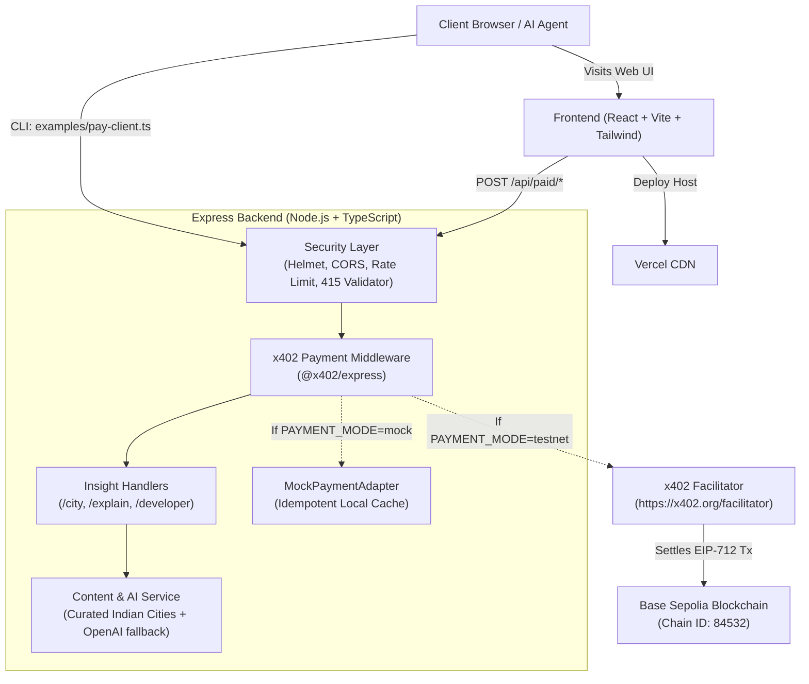
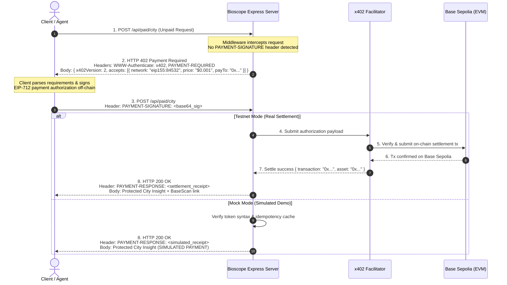

# 🎬 Bioscope AI — Pay Per Insight
### Built for the *Road to Devcon VI — x402: Pay-Per-Call* Hackathon

[](https://opensource.org/licenses/MIT)
[](https://www.typescriptlang.org/)
[](https://github.com/x402-foundation/x402)
[-blue.svg)](https://sepolia.basescan.org/)
[](https://nodejs.org/)

---

## 📽️ Overview

In historical India, a travelling showman wheeled an ornamental brass **bioscope** through village squares and dusty gallis. For a single copper coin dropped through a slot, curious onlookers peered through brass viewfinders into a darkened chamber to witness magical, illuminated moving reels.

**Bioscope AI** resurrects that exact cultural metaphor for the autonomous machine web: **One request. One tiny payment. One useful insight.**

Instead of forcing users and autonomous AI agents through high-friction subscription paywalls, $20/month SaaS plans, and invasive account logins, Bioscope AI protects high-value data and compute using the official **x402 payment standard**. Endpoints challenge clients with native `HTTP 402 Payment Required`; clients sign an EIP-712 payment authorization for fractions of a cent ($0.001); an x402 facilitator verifies and settles the micropayment directly on **Base Sepolia**; and the protected insight is instantly delivered.

---

## ✨ Standout Features

1. **Stateless HTTP-Native Micropayments (x402 Protocol v2)**: Eliminates cookies, API keys, KYC, and account logins. Every request is an atomic financial and computational exchange.
2. **Three Curated Bioscope Insight Chambers**:
   - 🧭 **City Bioscope** (`POST /api/paid/city` — `$0.001`): Deep cultural heritage, secret stepwells, artisanal culinary pairings, and bespoke itineraries for iconic Indian cities (*Nashik, Jaipur, Varanasi, Kochi, Mumbai*).
   - 💡 **Explainer Bioscope** (`POST /api/paid/explain` — `$0.002`): Precise cryptographic distillations, mental models, and key takeaways for frontier protocols (x402, ZKPs, consensus), with live AI inference or deterministic fallback.
   - 🛠️ **Developer Bioscope** (`POST /api/paid/developer` — `$0.001`): Architectural blueprints, type contracts, and copyable cURL commands for Web3 builders integrating x402.
3. **Dual Payment Engine with Strict Security Guard**:
   - **Real Testnet Settlement**: Connects via `@x402/express`, `@x402/evm` (`ExactEvmScheme`), and `@x402/fetch` to Coinbase CDP facilitators on Base Sepolia (`eip155:84532`), generating real verified transaction hashes and BaseScan explorer links.
   - **Local Simulated Demo Adapter**: Implements an RFC-compliant `MockPaymentAdapter` for instant zero-cost local development and automated CI. Produces clear `"SIMULATED PAYMENT — NO FUNDS TRANSFERRED"` receipts and explicitly **refuses to start if `NODE_ENV=production`**.
4. **Cinematic Product Aesthetics**: Dark film-grain atmosphere, warm amber brass refractions, bespoke SVG bioscope lens logo, and accessible typography (Cinzel & JetBrains Mono).
5. **Interactive Protocol Playground & Headless CLI**: Live 3-step header inspector in the browser plus a complete headless Node.js CLI script (`server/examples/pay-client.ts`).
6. **Comprehensive Test Suite**: 17 unit/integration tests with Vitest + Supertest covering health, catalog, 402 challenge headers, Zod validation, 415 media-type enforcement, replay protection, and rate limiting.

---

## 🏛️ System Architecture



---

## 🔄 x402 Payment Lifecycle Sequence



---

## 🚀 Installation & Local Run

### Prerequisites
- **Node.js**: Version 20.x or higher (tested on Node v24.15.0 LTS)
- **npm**: Version 10.x or higher
- **Git**

```powershell
# 1. Clone repository
git clone https://github.com/lahotida-wq/bioscope-ai-x402.git
cd bioscope-ai-x402

# 2. Install monorepo dependencies
npm install

# 3. Create local environment file from template
cp .env.example .env

# 4. Run entire suite concurrently (Frontend: http://localhost:5173, Backend: http://localhost:4000)
npm run dev
```

Alternatively, run workspaces individually:
```powershell
# Run backend only
npm run dev:server

# Run frontend only
npm run dev:client
```

---

## ⚙️ Environment Variables Reference

| Variable | Required? | Default | Description & How to Obtain |
|---|---|---|---|
| `PORT` | Optional | `4000` | Port for the Express backend server. |
| `NODE_ENV` | Required | `development` | Environment mode (`development`, `production`, `test`). Server strictly refuses to run with `PAYMENT_MODE=mock` in production. |
| `PAYMENT_MODE` | Required | `mock` | `mock` for zero-cost local demo; `testnet` for real Base Sepolia on-chain settlement. |
| `PAYMENT_RECIPIENT_ADDRESS` | Required (testnet) | `0x000000000000000000000000000000000000dEaD` | 42-character EVM address to receive payments. Use your own MetaMask or Coinbase Wallet address. |
| `X402_FACILITATOR_URL` | Required | `https://x402.org/facilitator` | Official testnet facilitator endpoint from x402 Foundation. |
| `X402_NETWORK` | Required | `eip155:84532` | CAIP-2 network identifier for Base Sepolia testnet. |
| `X402_ASSET_ADDRESS` | Required | `0x036CbD53842c5426634e7929541eC2318f3dCF7e` | Contract address for testnet USDC on Base Sepolia. |
| `PRICE_CITY_BIOSCOPE` | Optional | `$0.001` | Human-readable price for City Bioscope insight. |
| `PRICE_EXPLAIN_BIOSCOPE` | Optional | `$0.002` | Human-readable price for Explainer Bioscope insight. |
| `PRICE_DEVELOPER_BIOSCOPE` | Optional | `$0.001` | Human-readable price for Developer Bioscope insight. |
| `CORS_ORIGIN` | Optional | `http://localhost:5173` | Allowed frontend origins (comma-separated or `*`). |
| `RATE_LIMIT_WINDOW_MS` | Optional | `60000` | Rate limiter window in milliseconds (1 minute). |
| `RATE_LIMIT_MAX_REQUESTS` | Optional | `100` | Max requests allowed per window per IP. |
| `OPENAI_API_KEY` | Optional | `""` | Optional OpenAI key (`sk-...`). If omitted, returns rich deterministic explanations labelled "DEMO IMPLEMENTATION". |
| `VITE_API_URL` | Optional | `http://localhost:4000` | Frontend API URL pointing to the backend server. |
| `TESTNET_PRIVATE_KEY` | Optional (CLI testnet) | `""` | EVM private key for the CLI test client to fund testnet payments. Never commit real keys! |

---

## 🧪 Local Demo Steps (Simulated Mode)

1. Ensure `.env` has `PAYMENT_MODE=mock`.
2. Start the dev server: `npm run dev`.
3. Open `http://localhost:5173` in your browser.
4. Notice the amber top banner: **`SIMULATED PAYMENT — NO FUNDS TRANSFERRED`**.
5. Select **City Bioscope**, choose **Nashik**, and click **Unlock Insight for $0.001**.
6. Observe the real-time x402 exchange:
   - Initial call triggers `HTTP 402` with payment requirements.
   - Client signs simulated payment authorization.
   - Server validates idempotency and returns `HTTP 200 OK` with `PAYMENT-RESPONSE` settlement receipt.
   - The verified Nashik heritage and culinary itinerary is displayed.
7. Scroll down to the **Interactive API Playground** to inspect raw HTTP request and response headers.
8. Run the CLI client:
   ```powershell
   npm run cli:pay --workspace=server
   ```

---

## ⛓️ Real Testnet Steps (Base Sepolia Settlement)

To experience genuine on-chain payment settlement with real USDC on Base Sepolia:

### 1. Obtain Testnet Credentials & Wallet
1. Create a developer account at [Coinbase Developer Platform (CDP)](https://docs.cdp.coinbase.com/).
2. Create or export a dedicated testnet EVM wallet (e.g. from Coinbase Wallet or MetaMask).
3. Fund your wallet with **Base Sepolia ETH** (for gas) using the [Coinbase Developer Faucet](https://www.coinbase.com/faucets/base-ethereum-sepolia-faucet).
4. Mint testnet **USDC** on Base Sepolia (`0x036CbD53842c5426634e7929541eC2318f3dCF7e`).

### 2. Configure Backend for Testnet
In your `.env`:
```env
PAYMENT_MODE=testnet
PAYMENT_RECIPIENT_ADDRESS=0xYourEVMWalletAddressHere
X402_FACILITATOR_URL=https://x402.org/facilitator
X402_NETWORK=eip155:84532
X402_ASSET_ADDRESS=0x036CbD53842c5426634e7929541eC2318f3dCF7e
```

### 3. Run Real Payment via CLI Client
Add your funded testnet private key to `.env` (kept strictly local):
```env
TESTNET_PRIVATE_KEY=0xYourPrivateKey64HexCharacters...
```
Then execute:
```powershell
npm run cli:pay --workspace=server
```
**Outcome**:
- `@x402/fetch` and `@x402/evm` (`ExactEvmScheme`) sign the payment authorization payload with your private key.
- The server submits the signed authorization to `https://x402.org/facilitator`.
- The facilitator broadcasts and settles the transaction on Base Sepolia.
- The script outputs the confirmed **transaction hash** and clickable **BaseScan link**: `https://sepolia.basescan.org/tx/0x...`.

---

## 📡 API Reference

### 1. `GET /api/health`
Public health status, payment mode, network, and uptime.
```bash
curl -i http://localhost:4000/api/health
```

### 2. `GET /api/experiences`
Public catalog of bioscope chambers, pricing, and preview snippets.
```bash
curl -i http://localhost:4000/api/experiences
```

### 3. `POST /api/paid/city` (Protected by x402)
- **Price**: `$0.001` (Configurable via `PRICE_CITY_BIOSCOPE`)
- **Headers**:
  - `Content-Type: application/json`
  - `PAYMENT-SIGNATURE: <auth_token>` (Required for fulfillment)
- **Request Body**:
```json
{
  "city": "Nashik",
  "interests": ["vineyards", "temples", "culinary"]
}
```
- **Unpaid Response (HTTP 402)**:
```json
{
  "x402Version": 2,
  "error": "PAYMENT_REQUIRED",
  "message": "Payment required to access this Bioscope insight resource.",
  "resource": {
    "path": "/api/paid/city",
    "method": "POST",
    "description": "City Bioscope — Deep Cultural, Culinary & Travel Insights"
  },
  "accepts": [
    {
      "scheme": "exact",
      "price": "$0.001",
      "network": "eip155:84532",
      "payTo": "0x000000000000000000000000000000000000dEaD",
      "maxTimeoutSeconds": 60,
      "asset": "0x036CbD53842c5426634e7929541eC2318f3dCF7e"
    }
  ]
}
```
- **Paid Response (HTTP 200 OK)**:
Delivers detailed city history, highlights, hidden gems, 2-day itinerary, and culinary pairings.

### 4. `POST /api/paid/explain` (Protected by x402)
- **Price**: `$0.002`
- **Request Body**: `{ "topic": "x402 Protocol", "difficulty": "intermediate" }`

### 5. `POST /api/paid/developer` (Protected by x402)
- **Price**: `$0.001`
- **Request Body**: `{ "topic": "x402 Middleware", "language": "typescript" }`

---

## 🧪 Testing Results (Simulated vs Live)

Execute all verification scripts from the root:
```powershell
# Run simulated test suite (17 tests)
npm run test

# Run full project checks (lint + typecheck + test + build)
npm run check

# Optional: Run live testnet settlement (requires funded TESTNET_PRIVATE_KEY)
npm run test:live
```

### Test Suite Execution Output
```
✓ tests/server.test.ts (17 tests)
  ✓ GET /api/health returns ok status and server metadata
  ✓ GET /api/experiences returns public catalog with prices and preview data
  ✓ POST /api/paid/city returns 402 Payment Required when unpaid
  ✓ POST /api/paid/explain returns 402 Payment Required when unpaid
  ✓ POST /api/paid/developer returns 402 Payment Required when unpaid
  ✓ POST with non-JSON content-type returns 415 Unsupported Media Type
  ✓ POST /api/paid/city fulfills request when valid payment signature is provided
  ✓ POST /api/paid/explain delivers deterministic explainer when paid
  ✓ POST /api/paid/developer delivers technical blueprint and curl example when paid
  ✓ Rejects invalid payload with 400 Bad Request
  ✓ Rejects malformed payment signature with 400
  ✓ Handles simulated facilitator failure gracefully with 502
  ✓ Handles simulated settlement failure gracefully with 402
  ✓ Idempotently serves duplicate requests without charging twice
  ✓ Rejects replayed token when configured for strict replay rejection
  ✓ Refuses to load config or boot when NODE_ENV=production and PAYMENT_MODE=mock
  ✓ Throttles excessive requests when rate limit is exceeded

Test Files  1 passed | 1 skipped (live testnet skipped when no private key configured)
Tests       17 passed (100% passing)
```

> [!NOTE]
> **Honest Verification Disclosure**: The simulated test suite thoroughly tests RFC HTTP 402 challenge-response dynamics, headers, payload validation, idempotency caching, and production security guards. Live blockchain transactions are only executed when an authorized tester supplies a funded `TESTNET_PRIVATE_KEY` for `npm run test:live` or `npm run cli:pay`.

---

## 🚢 Production Deployment

### Frontend (Vercel)
The client directory includes a pre-configured `client/vercel.json`:
1. Connect your GitHub repository to Vercel.
2. Set Root Directory to `client`.
3. Set Environment Variable: `VITE_API_URL=https://your-backend.onrender.com`.
4. Deploy!

### Backend (Render / Docker)
A production multi-stage `server/Dockerfile` and `server/render.yaml` are included:
```bash
# Build Docker image
docker build -f server/Dockerfile -t bioscope-ai-server .

# Run container in testnet mode
docker run -p 4000:4000 \
  -e NODE_ENV=production \
  -e PAYMENT_MODE=testnet \
  -e PAYMENT_RECIPIENT_ADDRESS=0xYourAddress \
  bioscope-ai-server
```

---

## 🔒 Security Notes & Defenses

- **Production Mock Guard**: The server uses a Zod schema refinement that **throws a fatal error on boot** if `NODE_ENV === 'production'` and `PAYMENT_MODE === 'mock'`. Mock mode can never bypass payment enforcement on a live public deployment.
- **Strict Payload & Media-Type Enforcing**: All POST requests must declare `Content-Type: application/json` or receive `415 Unsupported Media Type`. Body size is strictly capped at `50kb` to eliminate payload inflation vectors.
- **Idempotency & Replay Protection**: Authorizations are tracked in an internal idempotency store. Duplicate requests with an already settled signature are served without re-charging.
- **No Private Keys in Browser**: Browser client code contains zero cryptographic private keys. Payments are either settled through client wallet providers or executed headlessly via `pay-client.ts`.
- **Safe Error Handling**: The server catches all unhandled exceptions, sanitizing stack traces and database details before returning a clean `{ error, message }` JSON envelope.

---

## 📋 Hackathon Submission Checklist

- [x] Monorepo npm workspaces (`client/` and `server/`)
- [x] Official `@x402/express`, `@x402/evm`, `@x402/core`, `@x402/fetch` integration (v2.28.0)
- [x] HTTP 402 challenge flow with `WWW-Authenticate` and `PAYMENT-REQUIRED` headers
- [x] Base Sepolia network configuration (`eip155:84532`)
- [x] Fail-fast Zod environment validation with production mock guard
- [x] Three unique protected insight chambers (City, Explainer, Developer)
- [x] Standalone CLI payment client (`server/examples/pay-client.ts`)
- [x] 17 passing automated unit and integration tests
- [x] Dark cinematic user interface with responsive layout and accessibility
- [x] Interactive API playground and transaction receipt inspector
- [x] Deployment configurations (`vercel.json`, `Dockerfile`, `render.yaml`)
- [x] Zero secrets committed to git (`.gitignore` verified)

---

## 📄 License
This project is open-source software licensed under the [MIT License](LICENSE).
